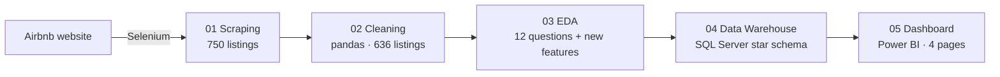
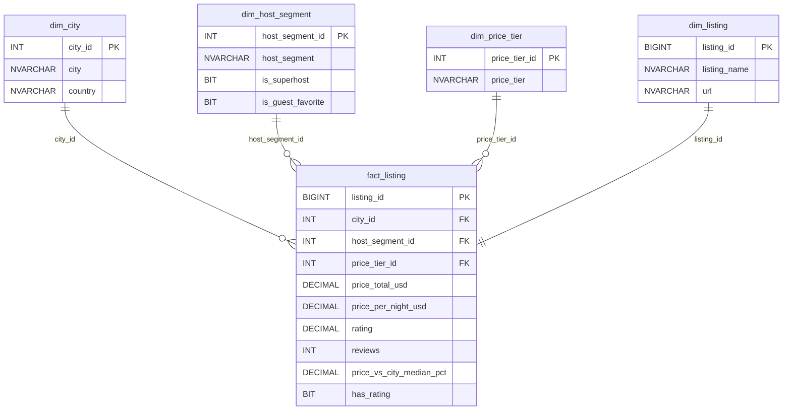

# Airbnb Europe Market Analysis

An end-to-end data analytics project on Airbnb listings in 15 European cities: web scraping with Selenium, data cleaning and exploratory analysis in Python, a star-schema data warehouse in SQL Server, and an interactive Power BI dashboard.

The project focuses on **entire homes/apartments with 2 bedrooms** and answers questions such as: which cities are the most expensive, do Superhosts charge more, does a higher price mean a better rating, and where are the best-value stays.

| | |
|---|---|
| **Cities** | Amsterdam, Athens, Barcelona, Berlin, Budapest, Copenhagen, Dublin, Lisbon, London, Madrid, Milan, Paris, Prague, Rome, Vienna |
| **Listings** | 750 scraped → 636 after cleaning |
| **Collected** | October 2026 |
| **Tools** | Python (Selenium, pandas, seaborn, SciPy, SQLAlchemy), SQL Server, Power BI |

---

## Pipeline



## Repository structure

```
Airbnb-Europe-Market-Analysis/
├── 01_Scraping/
│   └── Airbnb_Scraping.ipynb        # Selenium scraper (search pages + listing pages)
├── 02_Cleaning/
│   └── Airbnb_Cleaning.ipynb        # Types, currency, duplicates, bedroom filter
├── 03_EDA/
│   └── Airbnb_EDA.ipynb             # 12 business questions, feature engineering
├── 04_Data_Warehouse/
│   ├── AirbnbDW.sql                 # Database, tables, view, validation and analysis queries
│   └── Airbnb_Load_to_DWH.ipynb     # Loads dimensions and fact table into SQL Server
├── 05_Dashboard/
│   ├── Airbnb_Dashboard.pbix        # Power BI report
│   ├── screenshots/                 # Dashboard page images used in this README
│   └── assets/
│       ├── theme/                   # Power BI theme, background, navigation buttons
│       └── kpi_icons/               # KPI card icons
├── data/
│   ├── raw/
│   │   └── Airbnb_Scraped_Data.csv  # Scraper output (750 rows)
│   └── processed/
│       ├── Airbnb_Cleaned.csv       # Cleaned data (636 rows)
│       └── eda_tables/              # Enriched data and summary tables used by the warehouse
├── requirements.txt
└── README.md
```

---

## 1. Scraping

`01_Scraping/Airbnb_Scraping.ipynb`

- Opens an Airbnb search per city with the filters **Entire home/apt** and **2+ bedrooms** already in the URL.
- Collects the listing links from each results page, opens every listing in a new tab and extracts: name, price, Superhost badge, Guest Favorite badge, rating and number of reviews.
- Moves through result pages until it has 50 listings per city.
- Saves a backup after every city and stops automatically if a city returns no listings (a sign of being blocked), so a long run never loses data.

Problems solved along the way:

| Problem | Fix |
|---|---|
| Headless Chrome returned no results | Run with a visible browser window |
| A long, fragile XPath for the price stopped working | Read the price from the text of the booking box with a regular expression |
| For Guest Favorite listings the rating and review count were glued together (e.g. `97322` instead of `4.97` and `322`) | Read each small text element separately |
| Temporary IP blocks (HTTP 503) | Random waits between listings and cities, backup after each city |

## 2. Cleaning

`02_Cleaning/Airbnb_Cleaning.ipynb`

| Step | Result |
|---|---|
| Price text (`ج.م 51,630`) → number, EGP → USD at a fixed rate of **50.5 EGP/USD** | `Price_total_USD` (5 nights) and `Price_per_night_USD` |
| `Rating`: `New` and missing values → empty (NaN), not 0 or the mean | 80 listings without a rating |
| `Superhost`: Yes/No → 1/0 | |
| Duplicates by listing id (the same listing appeared on two result pages) | 61 rows removed |
| Listings with 3+ bedrooms (the search filter means *at least* 2) removed by name, e.g. `3BR`, `4 bedrooms` | 53 rows removed |
| **Final dataset** | **636 listings**, 36–47 per city |

## 3. Exploratory data analysis

`03_EDA/Airbnb_EDA.ipynb` answers 12 questions (city and country prices, price distribution and outliers, Superhost and Guest Favorite effects, price vs rating and reviews, best-value listings, correlations) and creates new features:

| Column | Meaning |
|---|---|
| `country` | Country of the city |
| `has_rating` | 1 if the listing has a numeric rating |
| `price_tier` | Budget / Mid-range / Upper / Luxury (price quartiles) |
| `rating_category` | Excellent, Good, Fair or Unrated |
| `review_level` | No reviews, 1–9, 10–49, 50–199, 200+ |
| `host_segment` | Superhost + Guest Favorite, Superhost only, Guest Favorite only, Standard |
| `price_vs_city_median_pct` | How much cheaper or more expensive the listing is than its city's median (%) |

## 4. Data warehouse (SQL Server)

`04_Data_Warehouse/`



- **Star schema**: one fact table (one row per listing) and four dimensions, with primary and foreign keys.
- **ETL**: transformations are done in Python; `Airbnb_Load_to_DWH.ipynb` loads the dimensions first and then the fact table with SQLAlchemy + pyodbc, taking the generated keys back from SQL Server.
- **`vw_listings`**: a view that joins all tables for analysis.
- **`AirbnbDW.sql`** also contains validation queries (row counts per table and per city) and 6 analysis queries using window functions (`PERCENTILE_CONT`, `RANK`, `ROW_NUMBER`) and conditional aggregation.

## 5. Power BI dashboard

`05_Dashboard/Airbnb_Dashboard.pbix` is connected to the warehouse tables (Import mode) and keeps the star-schema relationships. It has 4 pages with a shared city slicer and custom navigation buttons:

| Page | What it shows |
|---|---|
| **Overview** | Main KPIs, median price by city, host type mix, price distribution, guest activity by country |
| **City** | City ranking table, price vs Europe median, price vs rating by city |
| **Host** | Superhost and Guest Favorite shares, Superhost price premium by city, host type performance |
| **Value** | Price tiers, reviews and rating by tier, best-value listings |

<!-- Add the exported page images to 05_Dashboard/screenshots/ with these names -->


---

## Key findings

- **Amsterdam is the most expensive city** (median **$556**/night) and **Athens the cheapest** (**$141**), a **3.95x** gap. Six cities are above the overall median of **$292**: Amsterdam, Paris, Copenhagen, Dublin, London and Barcelona.
- **A higher price does not mean a better rating.** The average rating is **4.91** and barely changes across price tiers (4.90 in Budget, 4.93 in Luxury). Price vs rating correlation is only **0.09**.
- **Cheaper listings get more reviews** (a proxy for bookings): **158** on average in the Budget tier vs **102** in Luxury.
- **Guest Favorite listings get almost twice the reviews** of other listings (**161 vs 82**, 1.96x) and higher ratings (4.94 vs 4.84), without being more expensive.
- **Superhosts and Simpson's paradox.** Across all cities Superhosts look **1.7% cheaper**, yet inside **11 of 15 cities** they charge more (up to **+37%** in London). The reason is the city mix: Superhosts are concentrated in cheaper cities (**77%** of listings in Prague and **74%** in Athens, vs **33%** in Paris), which pulls their overall average down. Comparisons should be made within each city.
- **London has the least established supply**: **34%** of its listings have no rating yet, vs **13%** overall.
- **56 best-value listings** (rating ≥ 4.9, 50+ reviews, at least 10% cheaper than their city's median), most of them in **Prague** (10).

## Assumptions and limitations

- Prices are the **5-night totals including all fees** that Airbnb showed for each listing's suggested dates (October–November 2026). `Price_per_night_USD` is that total divided by 5.
- Prices were displayed in EGP and converted with **one fixed rate (50.5 EGP = 1 USD)**, so absolute values are approximate; comparisons between cities are not affected.
- Up to 50 listings per city were collected from the search results, so this is a **sample**, not the whole market.
- Listings with 3+ bedrooms were removed **by their name only**, so a few may remain.
- Missing ratings were kept empty instead of filled, so averages only use rated listings.
- The number of reviews is used as an indicator of demand; Airbnb does not publish bookings.
- The scraper depends on Airbnb's page structure, which changes often.

## How to run

1. **Install the requirements** (Python 3.11+ and Google Chrome):
   ```bash
   pip install -r requirements.txt
   ```
2. **Scraping (optional)**: run `01_Scraping/Airbnb_Scraping.ipynb`. The scraped data is already in `data/raw/`, and Airbnb may block or change its pages.
3. **Cleaning and EDA**: run `02_Cleaning/Airbnb_Cleaning.ipynb` and then `03_EDA/Airbnb_EDA.ipynb`. They read and write under `data/`.
4. **Warehouse**:
   - In SQL Server Management Studio, run sections 1 and 2 of `04_Data_Warehouse/AirbnbDW.sql` (database, tables and view).
   - In `04_Data_Warehouse/Airbnb_Load_to_DWH.ipynb`, set `server` to your SQL Server instance and run the notebook **once**. Running the load again fails on the primary keys; clear the tables first if you need to reload.
   - Sections 3 and 4 of the SQL file contain the validation and analysis queries.
5. **Dashboard**: open `05_Dashboard/Airbnb_Dashboard.pbix`, go to **Transform data → Data source settings → Change Source**, set your server and refresh.

## Credits

- KPI icons are based on [Lucide](https://lucide.dev) icons (ISC License).
- This project is for educational purposes. The data was collected from public Airbnb listing pages; please respect Airbnb's terms of service if you reuse the scraper.
